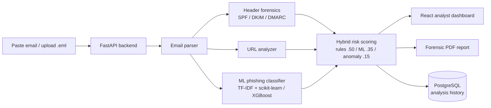

# MailShield AI

AI-Powered Email Threat Detection and Forensic Analysis System

Paste an email or upload a `.eml` file and MailShield AI returns an explainable verdict in seconds: header forensics, malicious link analysis, and an ML phishing score combined into one hybrid risk score, with a downloadable forensic PDF report.

**Live demo:** https://mailshield-web.vercel.app (backend: https://mailshield-backend-qsgo.onrender.com) — load the PayPal sample and hit Analyse. The model binary is not committed, so the hosted backend trains the ML model during its Render build (guarded: if training ever fails, the deploy still succeeds and verdicts renormalise over rules + anomaly, with the dashboard saying so). `GET /health` on the backend reports whether the model is loaded.

> **Origin — SIH26106:** Built from Smart India Hackathon 2026 problem statement SIH26106 (Ministry of Home Affairs, National Cyber Crime Training Centre, Blockchain & Cybersecurity). Idea submissions for SIH 2026 closed in October 2026, so this project is **not** a live SIH 2026 submission. It is built for GitHub, college internal selection, and SIH 2027 preparation.

## What it does (MVP)

- **Email input** — paste raw email text or upload a `.eml` file
- **Header forensics** — SPF / DKIM / DMARC results, From vs Reply-To mismatch, spoofed sender detection, Received chain and originating IP
- **URL analysis** — extracts all links and flags IP-based URLs, URL shorteners, punycode domains, look-alike / typosquatted domains, and display-text vs href mismatch
- **Threat-feed matching** — analysed URLs (including QR-decoded ones) are matched locally against cached copies of the OpenPhish community feed and the Phishing.Database active-links list, refreshed in the background with a TTL and fail-open if unreachable. PhishTank's full feed is not used: it requires an API key, and MailShield takes no API keys
- **Homograph detection** — UTS #39 confusable skeletons catch Cyrillic/Greek/fullwidth look-alike domains imitating protected brands
- **Attachment triage** — static inspection for dangerous extensions, double extensions, archive contents, Office macros (including `vbaProject.bin`), and PDF active content; nothing is executed
- **Received timing + geolocation** — hop timestamp anomalies (future-dated, negative delays, multi-day gaps, all informational) and a passive, cached ip-api.com lookup of the originating IP
- **IOC export** — one-click CSV (defanged) and STIX 2.1 bundle export of every indicator in an analysis, via `POST /report/iocs/email` and `/report/iocs/eml` with `?format=csv|stix`
- **Redirect + landing-page analysis** — link destinations are followed server-side (max 5 hops, ~4 s budget, response-size cap, no JavaScript) and the landing page is inspected for credential-harvest signals: password fields, forms posting to a different domain, brand impersonation. SSRF-guarded: hosts resolving to private/loopback/link-local addresses are refused, and URLs already matched by a threat feed are not fetched
- **BEC / payment-fraud intent** — a dedicated module reads the message's intent: bank-detail changes, wire requests, gift-card and payroll-diversion asks, secrecy pressure, and executive-impersonation framing backed by a free-mail or diverted-reply sender. Signals carry evidence snippets and ride the anomaly weight; a stateless tool sees one message, so sender-history claims are never made
- **Optional LLM explanation** — `POST /explain/email` and `/explain/eml` narrate a finished analysis in plain language via Google Gemini. Off unless the operator sets `GEMINI_API_KEY` in the environment (on the current hosted service it is not set, and the endpoint says so). The prompt is built only from the structured findings — never the raw email — and the explainer has no path into scoring
- **Optional transformer second opinion** — a pre-trained DistilBERT-class phishing classifier can be enabled with `SECOND_OPINION_MODEL` plus the extra dependencies in `backend/requirements-ml.txt`. Advisory only: it is attached to the response after the verdict and never feeds the hybrid score. Off by default everywhere, including the hosted deployment
- **ML phishing classifier** — trained on a real public phishing email dataset (see `ml/README.md`). Only real measured metrics are reported — no invented accuracy figures
- **Hybrid explainable risk score** — rules (0.50) + ML (0.35) + anomaly (0.15) combined into one score, with every reason listed
- **Analyst dashboard** — verdict, highlighted evidence, URL and header tables
- **Forensic PDF report** — downloadable report for each analysis

### Out of scope

Deep attachment sandboxing (see Architecture decisions), a full indicator correlation graph, and live mailbox / Gmail integration.

## Architecture decisions

- **Self-hosted rspamd — evaluated, not adopted.** rspamd is an excellent mail-filtering system, but it is a separate long-running service (with its own configuration, Redis and update cycle) designed to sit inside a mail server's delivery path. MailShield is a stateless analyser on free-tier hosting: there is no mail flow to plug rspamd into and no budget for a second always-on service. MailShield instead borrows rspamd's *ideas* — symbol-style explainable signals and scoring URL display/href mismatch separately — in its own rule modules.
- **Dangerzone — evaluated, not adopted.** Dangerzone renders attachments safely by converting them to pixels inside containers (gVisor/Docker). That sandbox infrastructure cannot run inside a stateless free-tier web service, and MailShield never executes attachments in the first place — its triage is purely static (structure, macros, active content, hashes). For a future self-hosted SOC deployment, Dangerzone-style safe viewing is the right complement; for this deployment it is the wrong shape.

## Architecture



## Tech stack

- **Backend:** FastAPI (Python)
- **Frontend:** React + Vite
- **Database:** PostgreSQL
- **ML:** scikit-learn / XGBoost, TF-IDF text features
- **Deployment:** Render (backend) + Vercel (frontend), same pattern as ShieldNet

## Project structure

```
backend/    FastAPI app — parser, header forensics, URL analysis, scoring, PDF reports
frontend/   React analyst dashboard
ml/         Training and evaluation pipeline, real measured metrics
samples/    Sample phishing and legitimate emails for the demo
docs/       Architecture and demo notes
```

## Quick start (local)

Backend:

```bash
cd backend
pip install -r requirements.txt
uvicorn app.main:app --reload --port 8000
# health check: http://localhost:8000/health
```

Frontend:

```bash
cd frontend
npm install
npm run dev
```

## Demo

See `docs/DEMO.md`. Sample emails are in `samples/` — start with `samples/phishing_paypal.eml` for a high-risk verdict and `samples/legit_college.eml` for a clean one.

Real hybrid verdicts on the samples (rules .50 / ML .35 / anomaly .15, measured 18 Nov 2026 with the trained model present):

| Sample | Rules | ML | Anomaly | Final score | Verdict |
|---|---|---|---|---|---|
| PayPal phishing | 90 | 100 | 100 | **95** | Phishing |
| Bank KYC phishing | 86 | 94 | 45 | **83** | Phishing |
| CUTM exam mail (legit) | 0 | 79 | 0 | **28** | Likely legitimate |
| GitHub digest (legit) | 0 | 73 | 0 | **26** | Likely legitimate |

Note the legit rows: the ML model alone over-scores short modern legitimate mail (see Evaluation), but clean headers and clean links pull the hybrid verdict into the legitimate band. That is the point of a hybrid system.

## Evaluation

Trained 18 Nov 2026 on real public corpora — Nazario Phishing Corpus (phishing) + SpamAssassin ham (legitimate), 5,778 emails, stratified 80/20 split. Full details and limitations in `ml/README.md`; raw numbers in `ml/metrics.json`, generated by `ml/evaluate.py`.

| Model | Accuracy | Precision | Recall | F1 |
|---|---|---|---|---|
| Logistic Regression (selected) | 0.9939 | 0.9951 | 0.9935 | 0.9943 |
| XGBoost | 0.9939 | 0.9935 | 0.9951 | 0.9943 |

These are in-domain held-out metrics on 2002–2007 corpora, reported exactly as measured — not a claim about accuracy on modern mail. See the honest-limitations section in `ml/README.md`.

## Related project

[ShieldNet](https://github.com/KaushikVegulla/ShieldNet) — AI-powered web security platform (WAF + ML). MailShield AI is its sister project for email, built as a standalone repository.

## Author

Vegulla Virendra Kaushik — BTech CSE (AI & ML), Semester 3, Centurion University of Technology and Management, Bhubaneswar.
