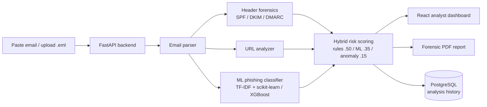

# MailShield AI

AI-Powered Email Threat Detection and Forensic Analysis System

Paste an email or upload a `.eml` file and MailShield AI returns an explainable verdict in seconds: header forensics, malicious link analysis, and an ML phishing score combined into one hybrid risk score, with a downloadable forensic PDF report.

> **Origin — SIH26106:** Built from Smart India Hackathon 2026 problem statement SIH26106 (Ministry of Home Affairs, National Cyber Crime Training Centre, Blockchain & Cybersecurity). Idea submissions for SIH 2026 closed in October 2026, so this project is **not** a live SIH 2026 submission. It is built for GitHub, college internal selection, and SIH 2027 preparation.

## What it does (MVP)

- **Email input** — paste raw email text or upload a `.eml` file
- **Header forensics** — SPF / DKIM / DMARC results, From vs Reply-To mismatch, spoofed sender detection, Received chain and originating IP
- **URL analysis** — extracts all links and flags IP-based URLs, URL shorteners, punycode domains, look-alike / typosquatted domains, and display-text vs href mismatch
- **ML phishing classifier** — trained on a real public phishing email dataset (see `ml/README.md`). Only real measured metrics are reported — no invented accuracy figures
- **Hybrid explainable risk score** — rules (0.50) + ML (0.35) + anomaly (0.15) combined into one score, with every reason listed
- **Analyst dashboard** — verdict, highlighted evidence, URL and header tables
- **Forensic PDF report** — downloadable report for each analysis

### Out of scope for MVP

Deep attachment sandboxing, full indicator correlation graph, and live mailbox / Gmail integration are planned for v2.

## Architecture



## Tech stack

- **Backend:** FastAPI (Python)
- **Frontend:** React + Vite
- **Database:** PostgreSQL
- **ML:** scikit-learn / XGBoost, TF-IDF text features
- **Deployment:** Render (backend) + Vercel (frontend), same pattern as ShieldNet

## Project structure

```
backend/    FastAPI app — parser, header forensics, URL analysis, scoring, PDF reports
frontend/   React analyst dashboard
ml/         Training and evaluation pipeline, real measured metrics
samples/    Sample phishing and legitimate emails for the demo
docs/       Architecture and demo notes
```

## Quick start (local)

Backend:

```bash
cd backend
pip install -r requirements.txt
uvicorn app.main:app --reload --port 8000
# health check: http://localhost:8000/health
```

Frontend:

```bash
cd frontend
npm install
npm run dev
```

## Demo

See `docs/DEMO.md`. Sample emails are in `samples/` — start with `samples/phishing_paypal.eml` for a high-risk verdict and `samples/legit_college.eml` for a clean one.

Real hybrid verdicts on the samples (rules .50 / ML .35 / anomaly .15, measured 18 Nov 2026 with the trained model present):

| Sample | Rules | ML | Anomaly | Final score | Verdict |
|---|---|---|---|---|---|
| PayPal phishing | 90 | 100 | 100 | **95** | Phishing |
| Bank KYC phishing | 86 | 94 | 45 | **83** | Phishing |
| CUTM exam mail (legit) | 0 | 79 | 0 | **28** | Likely legitimate |
| GitHub digest (legit) | 0 | 73 | 0 | **26** | Likely legitimate |

Note the legit rows: the ML model alone over-scores short modern legitimate mail (see Evaluation), but clean headers and clean links pull the hybrid verdict into the legitimate band. That is the point of a hybrid system.

## Evaluation

Trained 18 Nov 2026 on real public corpora — Nazario Phishing Corpus (phishing) + SpamAssassin ham (legitimate), 5,778 emails, stratified 80/20 split. Full details and limitations in `ml/README.md`; raw numbers in `ml/metrics.json`, generated by `ml/evaluate.py`.

| Model | Accuracy | Precision | Recall | F1 |
|---|---|---|---|---|
| Logistic Regression (selected) | 0.9939 | 0.9951 | 0.9935 | 0.9943 |
| XGBoost | 0.9939 | 0.9935 | 0.9951 | 0.9943 |

These are in-domain held-out metrics on 2002–2007 corpora, reported exactly as measured — not a claim about accuracy on modern mail. See the honest-limitations section in `ml/README.md`.

## Related project

[ShieldNet](https://github.com/KaushikVegulla/ShieldNet) — AI-powered web security platform (WAF + ML). MailShield AI is its sister project for email, built as a standalone repository.

## Author

Vegulla Virendra Kaushik — BTech CSE (AI & ML), Semester 3, Centurion University of Technology and Management, Bhubaneswar.
